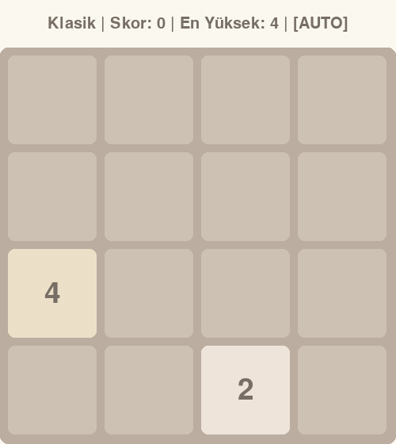

**English** | [Türkçe](README.tr.md)

# Alpha-Beta vs Expectimax in 2048

Two search agents, Alpha-Beta and Expectimax, play 2048 on their own and are compared on the same seeded games. Alpha-Beta treats each new tile as an adversary that places it in the worst possible spot, while Expectimax treats it as the random event it actually is. Over 100 games, Expectimax at depth 3 reached the 2048 tile in 74% of games, while Alpha-Beta's best setting reached it in 40%. The game is built with Pygame and serves as the environment the agents play in. Search and evaluation are compiled with Numba.



*Expectimax at depth 3, seed 40. The best of the 100 measured games (79,784 points, 4096 tile).*

Built with Python, Pygame, NumPy, Numba and Matplotlib.

## Agents

Both agents search a game tree in which player moves and tile spawns alternate. The search depth can be set when the game starts. Depth counts both kinds of layers, so depth 4 looks two player moves and two tile spawns ahead.

**Expectimax** treats a tile spawn as a chance event. Every empty cell is equally likely, and a new tile is a 2 with probability 0.9 and a 4 with probability 0.1, the same rule the game itself uses. The value of a spawn layer is the expected value over all these outcomes.

**Alpha-Beta** is minimax with alpha-beta pruning. It treats a tile spawn as an opponent that places a 2 or a 4 in the worst possible cell for the player. This plans for the worst case instead of the average case, and pruning lets it skip branches that cannot change the chosen move.

## Board evaluation

When the search reaches its depth limit, the board is scored as a weighted sum of six heuristics.

| Heuristic | What it measures | Weight |
|---|---|---|
| Empty cells | Number of empty cells | 270 |
| Monotonicity | How consistently each row and column increases or decreases | 47 |
| Smoothness | Penalty for large differences between neighbouring tiles, on a log2 scale | 10 |
| Merge potential | Number of equal neighbouring tiles that could merge | 700 |
| Corner bonus | Value of the largest tile if it sits in a corner | 1 |
| Snake pattern | Tile values weighted along a snake path that starts in the top left corner | 0.1 |

The weights are set in `evaluate()` in [agents/heuristics.py](agents/heuristics.py).

## Results

Each configuration played a fixed set of seeded games (seeds 0 to 99, or 0 to 29 for Expectimax depth 5). The same seed gives every agent the same starting board, and the agents themselves are deterministic.

| Agent | Depth | Games | Mean score | Median score | Best score | Reached 2048 | Reached 4096 | Time per move (ms) |
|---|---|---|---|---|---|---|---|---|
| Expectimax | 2 | 100 | 9,216 | 7,946 | 32,168 | 5% | 0% | 0.08 |
| Expectimax | 3 | 100 | 32,358 | 32,112 | 79,784 | 74% | 16% | 0.47 |
| Expectimax | 4 | 100 | 28,138 | 29,384 | 72,252 | 64% | 12% | 2.42 |
| Alpha-Beta | 3 | 100 | 18,113 | 16,260 | 52,200 | 27% | 1% | 0.19 |
| Alpha-Beta | 4 | 100 | 15,314 | 14,564 | 62,116 | 16% | 1% | 0.62 |
| Alpha-Beta | 5 | 100 | 21,438 | 18,020 | 53,208 | 39% | 2% | 2.32 |
| Alpha-Beta | 6 | 100 | 20,897 | 17,340 | 60,624 | 40% | 2% | 9.18 |
| Expectimax | 5 | 30 | 55,432 | 53,046 | 124,044 | 97% | 63% | 21.51 |

**Highlights from the 100 game runs**

- Expectimax at depth 3 reached the 2048 tile in 74% of games and the 4096 tile in 16%. Its best score was 79,784.
- For Alpha-Beta, depth 6 is the setting with the highest rate of reaching 2048, at 40% of games.
- Expectimax at depth 4 beats Alpha-Beta at depth 6 while spending about 4 times less time per move (2.42 ms against 9.18 ms). Its mean score is 28,138 against 20,897, and it reached 2048 in 64% of games against 40%.
- Deeper search did not always score higher in these runs. Expectimax depth 3 did better than depth 4, and Alpha-Beta depth 3 did better than depth 4.

**Additional finding with fewer games.** Expectimax at depth 5 was run on only 30 games, which took 55 seconds per game on average. In those games it reached 2048 in 29 games, 4096 in 19 games and 8192 in 2 games, with a best score of 124,044. It used 21.51 ms per move. With 30 games these rates are less certain than the 100 game results above.

**Numba speedup.** With JIT compilation the time per move was about 20 times shorter than in plain Python (21.9x for Expectimax and 19.8x for Alpha-Beta). This was measured at depth 3 over the first 30 moves of seeds 1, 2 and 3. Both versions chose exactly the same moves.

> Measured on an Intel Core i7-10700K with Windows 11, Python 3.12 and Numba 0.68. Time per move is wall clock time from `time.perf_counter()`, and Numba compilation was done before timing started. The results were measured on the code in the first commit of this repository, and [sysinfo.json](experiments/results/sysinfo.json) records the SHA-256 hashes of the measured source files. Later code changes were checked with [verify_replay.py](experiments/verify_replay.py), which replayed 427 of the 730 recorded games and got the same score, highest tile and number of moves in every one. Raw per game data is in [experiments/results](experiments/results).

## Installation

Tested on Windows with Python 3.12.

```bash
git clone https://github.com/merttereci/2048-ai.git
cd 2048-ai
python -m venv .venv
.venv\Scripts\activate
pip install -r requirements.txt
```

## Usage

The game window and console menus are in Turkish.

**Play or watch an agent**

```bash
python main.py
```

The menu offers manual play (1), Alpha-Beta (2) and Expectimax (3). For an agent you are asked for a search depth, and the default is 4. Before the game window opens, Numba compiles the search functions, which takes several seconds.

| Key | Action |
|---|---|
| Arrow keys or WASD | Move |
| Space | Start or pause the agent |
| R | Restart |
| Q or Esc | Quit |

After an agent game ends, you can choose to see graphs of nodes searched, time per move and score. If you do, they are also saved as a PNG file in the current folder.

**Quick benchmark**

```bash
python benchmark.py
```

Asks for the number of games and a depth for each agent, then plays both agents without a window on the same seeded games and prints a summary.

**Reproducing the results**

```bash
python experiments/cv_benchmark.py sysinfo
python experiments/cv_benchmark.py speedup
python experiments/cv_benchmark.py games --phase main
python experiments/cv_benchmark.py games --phase d5
python experiments/cv_benchmark.py summarize
```

These commands overwrite the files in `experiments/results`. Timings depend on the machine, so they will differ from the table above.

To check that the current code still plays exactly the recorded games, run the replay test. It does not measure time, so it gives the same answer on any machine.

```bash
python experiments/verify_replay.py          # quick subset
python experiments/verify_replay.py --all    # every recorded game
```

## Project structure

```
2048-ai/
├── main.py                  Entry point, menu and end of game graphs
├── benchmark.py             Headless comparison of the two agents
├── constants.py             Window size, colours and fonts
├── game/
│   ├── logic.py             Moves, merges and move checks (Numba)
│   ├── board.py             Board state, score and tile spawns
│   └── game_manager.py      Pygame loop, input and agent auto play
├── agents/
│   ├── base_agent.py        Common agent interface and statistics
│   ├── heuristics.py        The six heuristics and evaluate() (Numba)
│   ├── expectimax.py        Expectimax search (Numba)
│   └── alphabeta.py         Alpha-Beta search (Numba)
├── modes/                   Game modes (currently the classic mode)
├── renderer/                Pygame drawing
├── tools/
│   └── record_demo.py       Records the demo GIF from a recorded seeded game
└── experiments/
    ├── cv_benchmark.py      Seeded benchmark used for the results
    ├── verify_replay.py     Replays recorded games to check the code
    └── results/             Measured data and summaries
```
