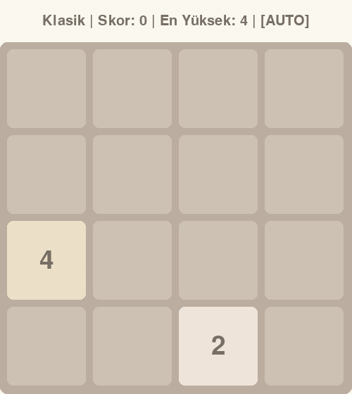

[English](README.md) | **Türkçe**

# 2048'de Alfa-Beta ve Expectimax Karşılaştırması

2048'i insan müdahalesi olmadan oynayan iki arama ajanı, Alfa-Beta ve Expectimax, aynı tohumlu oyunlar üzerinde karşılaştırılıyor. Alfa-Beta yeni gelen taşı onu en kötü yere koyan bir rakip gibi görürken, Expectimax taşın gerçekte olduğu gibi rastgele geldiğini hesaba katıyor. 100 oyunluk testte derinlik 3'teki Expectimax oyunların %74'ünde 2048 taşına ulaştı, Alfa-Beta en iyi ayarında %40'ta kaldı. Oyun Pygame ile yazıldı ve ajanların çalıştığı ortam olarak kullanılıyor, arama ve değerlendirme fonksiyonları Numba ile derleniyor.



*Expectimax derinlik 3, tohum 40. Ölçülen 100 oyunun en iyisi (79.784 puan, 4096 taşı).*

Kullanılan teknolojiler Python, Pygame, NumPy, Numba ve Matplotlib.

## Ajanlar

İki ajan da oyuncu hamleleriyle taş çıkışlarının sırayla geldiği bir oyun ağacında arama yapar. Arama derinliği oyun başlarken seçilir. Derinlik, her oyuncu hamlesini ve her taş çıkışını ayrı bir adım olarak sayar, yani derinlik 4 iki oyuncu hamlesi ve iki taş çıkışı ileriye bakar.

**Expectimax** taş çıkışını bir şans olayı olarak ele alır. Her boş hücrenin seçilme olasılığı eşittir ve yeni taş 0,9 olasılıkla 2, 0,1 olasılıkla 4 olur. Oyunun kendisi de aynı kuralı kullanır. Taş çıkışı katmanının değeri, tüm bu ihtimallerin beklenen değeridir.

**Alfa-Beta** alfa-beta budamalı minimax algoritmasıdır. Taş çıkışını, 2 ya da 4'ü oyuncu için en kötü hücreye koyan bir rakip gibi görür. Ortalama durum yerine en kötü duruma göre plan yapar. Budama sayesinde seçilecek hamleyi değiştiremeyecek dalları hiç açmaz.

## Tahta değerlendirmesi

Arama derinlik sınırına ulaştığında tahta, altı heuristic'in ağırlıklı toplamıyla puanlanır.

| Heuristic | Neyi ölçer | Ağırlık |
|---|---|---|
| Boş hücreler | Boş hücre sayısı | 270 |
| Monotonluk | Satır ve sütunların ne kadar düzenli arttığı ya da azaldığı | 47 |
| Düzgünlük | Komşu taşlar arasındaki büyük farklar için log2 ölçeğinde ceza | 10 |
| Birleştirme potansiyeli | Birleşebilecek eşit komşu taş sayısı | 700 |
| Köşe bonusu | En büyük taş köşedeyse o taşın değeri | 1 |
| Yılan deseni | Sol üst köşeden başlayan yılan biçimli bir yol boyunca ağırlıklandırılmış taş değerleri | 0,1 |

Ağırlıklar [agents/heuristics.py](agents/heuristics.py) dosyasındaki `evaluate()` fonksiyonunda tanımlı.

## Sonuçlar

Her ayar, sabit tohumlarla (seed) oynanan oyunlar üzerinden ölçüldü. Tohumlar 0 ile 99 arasında, Expectimax derinlik 5 için 0 ile 29 arasında. Aynı tohum her ajana aynı başlangıç tahtasını verir, ajanların kendisi de deterministik çalışır.

| Ajan | Derinlik | Oyun sayısı | Ortalama skor | Medyan skor | En yüksek skor | 2048'e ulaştı | 4096'ya ulaştı | Hamle başına süre (ms) |
|---|---|---|---|---|---|---|---|---|
| Expectimax | 2 | 100 | 9.216 | 7.946 | 32.168 | %5 | %0 | 0,08 |
| Expectimax | 3 | 100 | 32.358 | 32.112 | 79.784 | %74 | %16 | 0,47 |
| Expectimax | 4 | 100 | 28.138 | 29.384 | 72.252 | %64 | %12 | 2,42 |
| Alfa-Beta | 3 | 100 | 18.113 | 16.260 | 52.200 | %27 | %1 | 0,19 |
| Alfa-Beta | 4 | 100 | 15.314 | 14.564 | 62.116 | %16 | %1 | 0,62 |
| Alfa-Beta | 5 | 100 | 21.438 | 18.020 | 53.208 | %39 | %2 | 2,32 |
| Alfa-Beta | 6 | 100 | 20.897 | 17.340 | 60.624 | %40 | %2 | 9,18 |
| Expectimax | 5 | 30 | 55.432 | 53.046 | 124.044 | %97 | %63 | 21,51 |

**100 oyunluk ölçümlerden öne çıkanlar**

- Derinlik 3'teki Expectimax oyunların %74'ünde 2048, %16'sında 4096 taşına ulaştı. En yüksek skoru 79.784 oldu.
- Alfa-Beta'da 2048'e en sık ulaşan ayar derinlik 6 oldu. Bu ayarda oyunların %40'ında 2048 taşına ulaşıldı.
- Derinlik 4'teki Expectimax, hamle başına yaklaşık 4 kat daha az süre harcayarak (2,42 ms ve 9,18 ms) derinlik 6'daki Alfa-Beta'yı geçiyor. Ortalama skoru 28.138, Alfa-Beta'nınki 20.897. 2048'e ulaşma oranı ise %64, Alfa-Beta'da %40.
- Bu ölçümlerde daha derin arama her zaman daha iyi sonuç vermedi. Expectimax'ta derinlik 3, derinlik 4'ten daha iyi sonuç aldı. Alfa-Beta'da da derinlik 3, derinlik 4'ün önünde.

**Daha az oyuna dayanan ek bulgu.** Derinlik 5'teki Expectimax yalnızca 30 oyun oynadı, oyun başına ortalama 55 saniye sürdü. Bu oyunların 29'unda 2048, 19'unda 4096, 2'sinde 8192 taşına ulaştı. En yüksek skoru 124.044. Hamle başına 21,51 ms harcadı. Oyun sayısı az olduğu için bu oranlar yukarıdaki 100 oyunluk sonuçlar kadar güvenilir değil.

**Numba hızlanması.** JIT derlemesiyle hamle başına süre, düz Python'a göre yaklaşık 20 kat kısaldı. Expectimax'ta 21,9 kat, Alfa-Beta'da 19,8 kat. Bu ölçüm derinlik 3'te, 1, 2 ve 3 numaralı tohumların ilk 30 hamlesi üzerinden yapıldı. İki sürüm de birebir aynı hamleleri seçti.

> Ölçüm sistemi Intel Core i7-10700K, Windows 11, Python 3.12 ve Numba 0.68. Hamle başına süre `time.perf_counter()` ile ölçülen gerçek süredir ve Numba derlemesi ölçüm başlamadan önce yapıldı. Sonuçlar bu reponun ilk commit'indeki kodla ölçüldü. Ölçülen kaynak dosyaların SHA-256 özetleri [sysinfo.json](experiments/results/sysinfo.json) dosyasında kayıtlı. Sonradan yapılan kod değişiklikleri [verify_replay.py](experiments/verify_replay.py) ile kontrol edildi. Betik kayıtlı 730 oyundan 427 tanesini yeniden oynattı ve hepsinde aynı skor, aynı en büyük taş ve aynı hamle sayısı çıktı. Oyun bazındaki ham veriler [experiments/results](experiments/results) klasöründe.

## Kurulum

Windows'ta Python 3.12 ile test edildi.

```bash
git clone https://github.com/merttereci/2048-ai.git
cd 2048-ai
python -m venv .venv
.venv\Scripts\activate
pip install -r requirements.txt
```

## Kullanım

**Oynamak ya da ajanı izlemek için**

```bash
python main.py
```

Menüde manuel oyun (1), Alfa-Beta (2) ve Expectimax (3) seçenekleri var. Ajan seçildiğinde arama derinliği sorulur, varsayılan değer 4. Oyun penceresi açılmadan önce Numba arama fonksiyonlarını derler, bu birkaç saniye sürer.

| Tuş | İşlev |
|---|---|
| Yön tuşları ya da WASD | Hamle |
| Boşluk tuşu | Ajanı başlat ya da durdur |
| R | Yeniden başlat |
| Q ya da Esc | Çıkış |

Ajanın oyunu bittiğinde aranan düğüm sayısı, hamle süresi ve skor grafiklerini görmeyi seçebilirsiniz. Seçerseniz grafikler bulunduğunuz klasöre PNG olarak da kaydedilir.

**Hızlı karşılaştırma**

```bash
python benchmark.py
```

Oyun sayısını ve her ajan için derinliği sorar. Ardından iki ajanı aynı tohumlu oyunlarda pencere açmadan oynatır ve bir özet yazdırır.

**Sonuçları yeniden üretmek**

```bash
python experiments/cv_benchmark.py sysinfo
python experiments/cv_benchmark.py speedup
python experiments/cv_benchmark.py games --phase main
python experiments/cv_benchmark.py games --phase d5
python experiments/cv_benchmark.py summarize
```

Bu komutlar `experiments/results` klasöründeki dosyaların üzerine yazar. Süreler makineye bağlı olduğu için yukarıdaki tablodan farklı çıkacaktır.

Şu anki kodun kayıtlı oyunları birebir aynı oynadığını görmek için tekrar oynatma testini çalıştırabilirsiniz. Bu test süre ölçmediği için her makinede aynı sonucu verir.

```bash
python experiments/verify_replay.py          # hızlı alt küme
python experiments/verify_replay.py --all    # kayıtlı oyunların hepsi
```

## Proje yapısı

```
2048-ai/
├── main.py                  Giriş noktası, menü ve oyun sonu grafikleri
├── benchmark.py             İki ajanın arayüzsüz karşılaştırması
├── constants.py             Pencere boyutu, renkler ve fontlar
├── game/
│   ├── logic.py             Hamle, birleştirme ve hamle kontrolleri (Numba)
│   ├── board.py             Tahta durumu, skor ve taş çıkışı
│   └── game_manager.py      Pygame döngüsü, tuşlar ve ajanın otomatik oyunu
├── agents/
│   ├── base_agent.py        Ortak ajan arayüzü ve istatistikler
│   ├── heuristics.py        Altı heuristic ve evaluate() (Numba)
│   ├── expectimax.py        Expectimax araması (Numba)
│   └── alphabeta.py         Alfa-Beta araması (Numba)
├── modes/                   Oyun modları (şimdilik klasik mod)
├── renderer/                Pygame ile çizim
├── tools/
│   └── record_demo.py       Demo GIF'ini kayıtlı tohumlu bir oyundan üretir
└── experiments/
    ├── cv_benchmark.py      Sonuçlar için kullanılan tohumlu benchmark
    ├── verify_replay.py     Kodu kayıtlı oyunları tekrar oynatarak kontrol eder
    └── results/             Ölçülen veriler ve özetler
```
